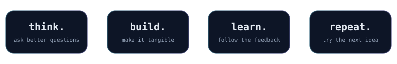
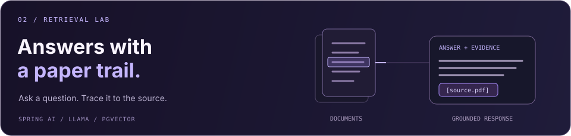

<!--
Saurav Kumar — GitHub profile
Upload the assets/ folder alongside this README so the custom animations load.
See PROFILE_SETUP.md for publishing and maintenance notes.
-->

<div align="center">



# Hey, I'm Saurav 👋

**Senior Software Engineer @ Samsung R&D Institute, Bangalore**

Backend engineering · Computer vision · AI applications

*From finding the right photo to finding the right answer.*

<br/>

[](https://sauravk21.github.io/profile/)
[](https://github.com/sauravk21)
[](mailto:saurav696854@gmail.com)

<br/>

[About me](#-a-little-about-me) &nbsp; · &nbsp; [Featured work](#-a-few-things-ive-built) &nbsp; · &nbsp; [Toolbox](#-my-toolbox) &nbsp; · &nbsp; [Experience](#-beyond-the-repositories) &nbsp; · &nbsp; [Connect](#-lets-build-something)

</div>


## 👨‍💻 A little about me

I'm **Saurav Kumar**, a software engineer working at the intersection of backend systems and applied AI. At Samsung, I've worked on faster duplicate-image detection, document classification, pet identification, and reliable image metadata migration between devices.

My projects bring those interests together: a selfie-powered event photo discovery system and a document Q&A application that shows where its answers came from. I graduated from **NIT Surathkal** with a **B.Tech. in Information Technology** in May 2024.

```console
sauravk21@dev:~$ whoami

Saurav Kumar / Software Engineer

backend  → APIs, databases, asynchronous processing
vision   → face embeddings, image clustering, classification
AI apps  → retrieval, document Q&A, model integration

sauravk21@dev:~$ _
```

<br/>

**A few results from my work at Samsung**



<div align="center">



</div>


## 🚀 A few things I've built

Two projects, one thread: making images and documents easier to search.

<table>
<tr>
<td valign="top">

<a href="https://github.com/sauravk21/Product-search-engine/tree/main"></a>

### [Event Photo Discovery System](https://github.com/sauravk21/Product-search-engine/tree/main)


**One selfie. Find your photos from an event.**

<details>
<summary><strong>Open the hood → processing, embeddings & search</strong></summary>

<br/>

Built a FastAPI backend for asynchronous image processing, face embedding generation, and clustering across uploaded event photos. Qdrant handles vector similarity search, while PostgreSQL stores the metadata needed to retrieve matching photos from an uploaded selfie.

**Worth a closer look:** connecting InsightFace embeddings, vector search, and relational metadata into a photo discovery workflow, with Next.js, Supabase, and Docker in the stack.

```text
Event photos → face embeddings → Qdrant index
Selfie       → query embedding → similar faces → photo metadata
```

</details>

[Explore the code →](https://github.com/sauravk21/Product-search-engine/tree/main)

</td>
</tr>
<tr>
<td valign="top">



### DocuRAG


**Ask your documents a question. Follow the answer back to the page.**

<details>
<summary><strong>Open the hood → retrieval, answers & citations</strong></summary>

<br/>

Built a full-stack Q&A application with Spring Boot, Spring AI, and Llama. The RAG pipeline uses PDFBox text extraction, semantic chunking, and pgvector cosine similarity search to retrieve grounded answers with page-level citations.

**Worth a closer look:** drag-and-drop PDF uploads, real-time processing status, multi-document selection, and collapsible source cards in React. The full stack runs through Docker Compose.

```text
PDFs     → text extraction → semantic chunks → vector index
Question → relevant passages → Llama → answer + page citations
```

</details>

<!-- The résumé's DocuRAG link points to the GitHub profile; replace it with a direct repository link when available. -->
[Visit my GitHub →](https://github.com/sauravk21/)

</td>
</tr>
</table>


## 🧭 What I work on

| Area | Problems I've worked on |
| :--- | :--- |
| 🔍 Search & retrieval | Finding photos from face embeddings and retrieving document passages for grounded answers. |
| 🧠 Applied AI | Integrating model inference, classification, and clustering into application workflows. |
| ⚙️ Backend systems | Optimizing database queries, designing schemas, and building reliable data migration flows. |

## 🛠️ My toolbox

<div align="center">

**Languages**


<br/><br/>

**Frameworks & Application Development**


<br/><br/>

**Data & Developer Tools**


<br/><br/>

**AI & Retrieval**


</div>

**Also in the toolkit:** Android · Mockito · SQL · REST APIs · Microservices · Distributed systems · Concurrency · NLP


## 📖 Beyond the repositories

<details>
<summary><strong>💼 Samsung R&D — experience & impact</strong></summary>

<br/>

### Senior Software Engineer · July 2024 – Present

**Samsung R&D Institute, Bangalore**

- **Duplicate-image detection:** optimized database query execution and added rule-based candidate filtering, delivering a **200× performance improvement** and reducing unnecessary image processing.
- **Document classification:** fine-tuned Tiny-BERT to increase accuracy from **70% to 92%**, then built the application layer for model inference and pipeline integration.
- **Pet identification:** implemented detection with BlazeFace, face embedding extraction, and clustering. Designed schemas and indexes for pet identities, embeddings, and image mappings to support personalized pet stories.
- **SmartSwitch:** developed image metadata migration across devices, covering database backup, encryption, transfer, decryption, validation, and restoration, with integrity checks and error handling.
- **Database migration:** moved service queries from an internal database to a standardized database, designed the target schema, and refactored data-access workflows.

### SDE Intern · May – July 2023

**Samsung R&D Institute, Bangalore**

Automated image segmentation dataset generation for a smartphone camera portrait image creation model, reducing dataset creation time by **50%**.

</details>

<details>
<summary><strong>🎓 Education, mentoring & milestones</strong></summary>

<br/>

- **National Institute of Technology Surathkal** — B.Tech., Information Technology · May 2024.
- **Samsung Prism Worklet** — mentored college students developing an AI model for text alignment detection in textual images.
- **JEE Advanced:** rank 5234 · **JEE Main:** rank 2742.
- **Foundations:** data structures and algorithms, database management, system design, object-oriented programming, concurrency, NLP, and computer vision.

</details>

<br/>

**Ask me about:** vector search, image processing pipelines, document Q&A, or the database work that makes an AI feature useful.


<br/>

<div align="center">

## 💬 Let's build something

**Have an idea involving backend systems, computer vision, or AI applications?**

I'd love to compare notes, talk through a tricky problem, or hear what you're building.

[](https://sauravk21.github.io/profile/)
[](https://github.com/sauravk21)
[](mailto:saurav696854@gmail.com)

<br/><br/>

<code>$ next_step --say-hello</code>

<br/><br/>

<sub>Good software starts with a question. What's yours?</sub>

<br/><br/>

[↑ Back to the top](#hey-im-saurav-)


</div>
